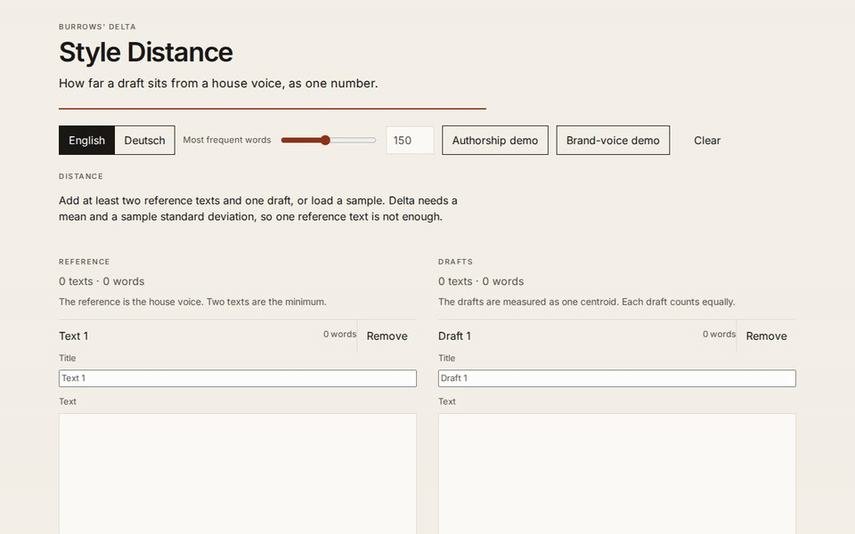

# Style Distance

Measure, in numbers, how far an AI draft has drifted from a house voice.



## Try it

No account and no model. The page measures in the browser.

```bash
npm ci
npm run dev
```

Open the app and either paste texts or load a sample.

- **Authorship demo.** Chapters from Jane Austen, *Pride and Prejudice*, and Charlotte Brontë, *Jane Eyre* (Project Gutenberg, public domain; the Gutenberg header and illustration blocks are removed). A held-out Austen chapter is scored against both novelists.
- **Brand-voice demo.** Synthetic. A made-up house voice, pages held out of that voice, and drafts written to leave it. Marked synthetic in the page and in `public/samples/brand.json`.

English and German. German keeps ä, ö, ü, and ß inside the word and scores the N most frequent words from a German function-word list. The default N is 150.

To ship it as a static Worker, with no server code and no secrets:

```bash
npm ci
npm run build
npx wrangler@4 deploy
```

`wrangler.jsonc` names the Worker `style-distance`, turns on `workers_dev`, turns off `preview_urls`, sets `compatibility_date` to `2026-10-01`, and serves `./dist` with single-page-application fallback. A `workers.dev` hostname can be opened by anyone who has the URL.

`npm run verify` runs the typecheck, lint, unit tests, the Python/TypeScript parity test, the production build, the Playwright smoke test, and pytest.

## How it measures

The number is Burrows’ Delta: the mean of the absolute differences between z-scores on the most frequent words.

John Burrows, “Delta: a Measure of Stylistic Difference and a Guide to Likely Authorship”, *Literary and Linguistic Computing* 17.3 (2002), 267–287. [doi:10.1093/llc/17.3.267](https://doi.org/10.1093/llc/17.3.267).

For one reference voice and one or more drafts:

1. Tokenise and lowercase. A word is a run of Latin letters, including German ä ö ü ß, with an ASCII apostrophe kept inside the word (`don't`). Casefolding is Unicode lower: ß stays ß, and `SS` is not rewritten to ß.
2. Relative frequency in a text is its count divided by the number of tokens.
3. Take the N most frequent words in the pooled reference texts, ranked by raw count. Ties break alphabetically. A word that occurs in only one reference text is left out: one text cannot establish a rate for the voice. For German, candidates are limited to `data/function-words-de.txt` before that ranking.
4. For each remaining word, take the mean and the sample standard deviation across the reference texts (divisor n − 1, the spreadsheet `STDEV`). A text that never uses the word contributes a zero. A word with standard deviation zero is dropped.
5. The draft side is the unweighted mean of the drafts’ relative frequencies. Each draft counts once, whatever its length.
6. z = (frequency − reference mean) / reference standard deviation. The reference centroid is zero in z-space, so Delta is the mean of |z|.
7. A word is over-used when the draft’s relative frequency is higher than the reference mean. Its contribution is |z|. The bars are those contributions, largest first.

The drafts do not enter the mean, the standard deviation, or the word list.

David L. Hoover’s walkthrough of Burrows on the single word *of* (mean 1.821, *Paradise Lost* at 2.769 and z = 3.015, Behn at 1.783 and z = −0.121, absolute difference 3.136) is the published check in the tests. Hoover, “Testing Burrows’s Delta”, *Literary and Linguistic Computing* 19.4 (2004), 453–475. [doi:10.1093/llc/19.4.453](https://doi.org/10.1093/llc/19.4.453).

With two reference voices, as in the authorship demo, the mean, the standard deviation, and the word list are taken from both voices together, and each distance is the mean |z of the draft − z of that voice|. One voice alone reduces to the procedure above. Comparing two voices each in its own units is a different, and here a biased, number: see the validation.

Sentence length is separate from Delta. Sentences split on `.` `!` and `?`, and a short abbreviation list (`Mr.`, `Mrs.`, `z.B.`, and the rest in `data/abbreviations.json`) does not end a sentence.

The plain-language reading uses cuts from the validation corpus, not from the synthetic drafts:

- **close** — at or under 0.79, the median same-author distance
- **drifting** — between the two medians
- **off-voice** — at or over 1.27, the median cross-author distance

Same-author and cross-author distances overlap (same-author 90th percentile 0.97, cross-author 10th percentile 0.75), so there is no empty gap to use as a cut. The medians are the cut. Exact values are in `data/thresholds.json`.

## Validation

Leave one chapter out of the 61 Austen chapters and 38 Brontë chapters that remain after dropping anything under 650 words. N = 150.

**One voice at a time** (the geometry of the single distance number). Distance to the rest of the same author, and distance to the other author, each in that author’s own z-scale:

| | median | 10th | 90th |
| --- | ---: | ---: | ---: |
| Same author | 0.785 | 0.637 | 0.972 |
| Other author | 1.272 | 0.750 | 1.528 |

Every held-out Austen chapter is nearer Austen than Brontë (61/61). Only 15 of 38 Brontë chapters are nearer Brontë. Austen’s chapters vary less, so distances measured in Austen’s standard deviations and distances measured in Brontë’s are not the same unit. The labels above use this geometry because it is the geometry of one house voice. They are not used to choose between two voices.

**One shared z-scale** (the authorship demo). Mean and standard deviation come from every training chapter of both novelists. The smaller distance wins.

| | median |
| --- | ---: |
| Same author | 0.703 |
| Other author | 0.933 |

97 of 99 chapters are attributed to their own author: 59/61 Austen, 38/38 Brontë. The two misses are Austen chapters XXVIII (1,451 words; 1.078 vs 1.052) and XXXIX (1,640 words; 0.964 vs 0.955). The margins are small. The demo chapter is Austen, Chapter X (2,219 words): 0.656 to Austen and 0.848 to Brontë.

The synthetic house voice is not part of the calibration. Against the cuts above, its drifted drafts score 1.33 (off-voice) and the pages held out of the house voice score 0.64 (close).

## What AI built and what I decided

The agent’s commits on `main`, after the initial stub:

- `478a998` — Add a Python reference for Burrows’ Delta.
- `e76a08b` — Add the validation corpus and the synthetic house voice.
- `4f45339` — Add the browser app and the checks around it.

The commit that added this section records the list. It does not add a measurement.

TODO(Jakob): the cut between close, drifting, and off-voice. It is the two medians above, because the distributions overlap. Your call if the cut should move.

TODO(Jakob): whether to run `npx wrangler@4 deploy`.

TODO(Jakob): whether this repository stays private.

TODO(Jakob): words to add or remove on the German function-word list.

## Limitations

Delta needs more than one reference text, because the spread is a sample standard deviation. One text has no spread.

It also needs enough text. On this chapter set, with the shared z-scale and every text cut to its first N words (only chapters at least that long):

| Words | Attributed to the right author |
| --- | ---: |
| 400 | 88 / 99 |
| 800 | 92 / 97 |
| 1,200 | 91 / 92 |
| 2,000 | 60 / 61 |
| Full chapter | 97 / 99 |

Below about 800 words the misses start to accumulate. Around 1,000 words is where a chapter in this corpus is usually long enough for the distance to settle. Shorter than that, the number is still a number, and it is noisy.

Delta does not read meaning, irony, or facts. It sees the rates of frequent words. A draft can be wrong and still score close, or right and still score off-voice, if the small words have moved.

The cuts are from two nineteenth-century English novelists. A house voice with a different amount of internal variation will not sit on the same scale. The words close, drifting, and off-voice are a reading of that calibration, not a law of brand voice.

In a short English sample the 150 most frequent words can include a repeated content word. In a long sample they are mostly function words. German never counts a content word: only the function-word list.

Names in dialogue (`Mr.`, `Mrs.`) are kept from splitting sentences. Other abbreviations will still split, and a line of dialogue can make a sentence look short.
